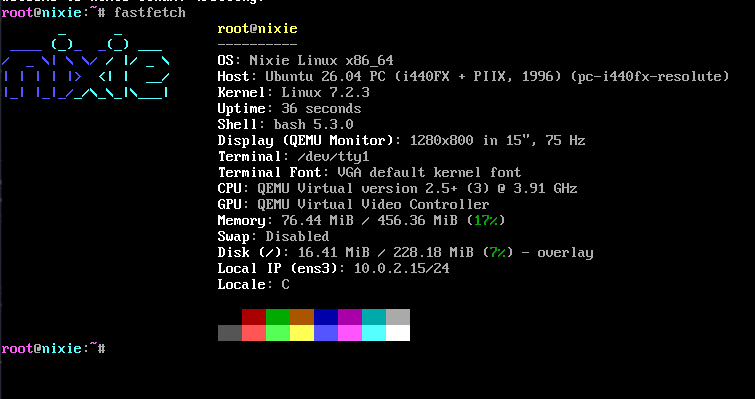

# nixie-linux
its real

## build
1. `$ bash tools/install-reqs.sh`
2. `$ sudo bash build.sh`
3. `$ sudo tools/isobuild.sh`

builds a file called `nixie-linux.iso`

note: theres no installer & package manager yet
